<a href="https://github.com/svviitzerland">
  <picture>
    <source media="(prefers-color-scheme: dark)" srcset="assets/header-dark.svg">
    
  </picture>
</a>

<p align="center">
  <a href="https://nimbus.farhanaulianda.my.id"><picture><source media="(prefers-color-scheme: dark)" srcset="assets/btn-nimbus-dark.svg">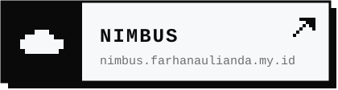</picture></a>
  <a href="mailto:hi@farhanaulianda.my.id"><picture><source media="(prefers-color-scheme: dark)" srcset="assets/btn-email-dark.svg">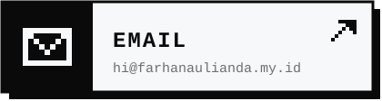</picture></a>
  <a href="https://instagram.com/farhanaulianda.py"><picture><source media="(prefers-color-scheme: dark)" srcset="assets/btn-instagram-dark.svg">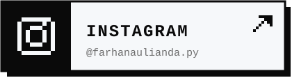</picture></a>
  <a href="https://twitter.com/farhanaulianda"><picture><source media="(prefers-color-scheme: dark)" srcset="assets/btn-x-dark.svg">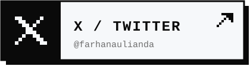</picture></a>
</p>

<br>

<picture>
  <source media="(prefers-color-scheme: dark)" srcset="assets/sec-1-dark.svg">
  
</picture>

<a href="https://nimbus.farhanaulianda.my.id">
  <picture>
    <source media="(prefers-color-scheme: dark)" srcset="assets/terminal-dark.svg">
    
  </picture>
</a>

<br><br>

<picture>
  <source media="(prefers-color-scheme: dark)" srcset="assets/sec-2-dark.svg">
  
</picture>

<a href="https://nimbus.farhanaulianda.my.id">
  <picture>
    <source media="(prefers-color-scheme: dark)" srcset="assets/nimbus-dark.svg">
    
  </picture>
</a>

<p align="center">
  <a href="https://nimbus.farhanaulianda.my.id"><picture><source media="(prefers-color-scheme: dark)" srcset="assets/btn-play-dark.svg">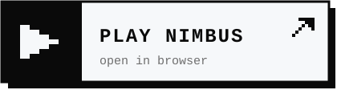</picture></a>
  <a href="https://github.com/svviitzerland/nimbus"><picture><source media="(prefers-color-scheme: dark)" srcset="assets/btn-source-dark.svg">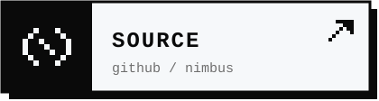</picture></a>
</p>

<details>
<summary><code>$ nimbus --help</code> &nbsp;<sub>click to expand</sub></summary>

<br>

```text
NIMBUS — learn cloud computing by playing

  Starts from absolute zero, like a game. Nim, a little mascot,
  explains every idea in plain words, then hands you a live stage:

  --globe      place a server on a spinnable globe, watch latency change
  --cable      ride a data packet along real undersea cables
  --outage     knock out a data center, see the site survive or fall
  --bill       trim a cloud bill

  bilingual (ID / EN) · no sign-up · phone or laptop · MIT
```

</details>

<br>

<picture>
  <source media="(prefers-color-scheme: dark)" srcset="assets/sec-3-dark.svg">
  
</picture>

<picture>
  <source media="(prefers-color-scheme: dark)" srcset="assets/stack-dark.svg">
  
</picture>

<br><br>

<picture>
  <source media="(prefers-color-scheme: dark)" srcset="assets/sec-4-dark.svg">
  
</picture>

<a href="https://github.com/svviitzerland?tab=repositories">
  <picture>
    <source media="(prefers-color-scheme: dark)" srcset="https://raw.githubusercontent.com/svviitzerland/svviitzerland/output/contributions-dark.svg">
    
  </picture>
</a>

<br><br>

<p align="center">
  <sub>always open to interesting conversations and collaborations — <a href="mailto:hi@farhanaulianda.my.id">hi@farhanaulianda.my.id</a></sub>
</p>

<picture>
  <source media="(prefers-color-scheme: dark)" srcset="assets/footer-dark.svg">
  
</picture>
